# Solana Telegram Trader

**A Solana trading bot built for speed, with every millisecond measured on mainnet.**

<picture>
  <source media="(prefers-color-scheme: dark)" srcset="docs/assets/pipeline-dark.svg">
  
</picture>

### In one minute
1. You press **Buy** in Telegram. Our Rust engine prices the trade from live data and
   **signs it in 0.2 ms**.
2. The **same signed transaction** is sent over three roads at once — straight to the
   Solana leaders (TPU), through Helius's staked connection, and through a normal RPC —
   and is on the wire in **~2 ms**.
3. The current leader puts it into its block.
4. Instead of waiting for an RPC to tell us, our own code reads the raw block data
   ("shreds") and spots our trade there — **~50 ms after sending, 13 ms at best**.

> **Status:** private beta, **unaudited**, custodial test wallets, mainnet trading
> **off by default**. Do not use with funds you cannot lose.
> See [docs/KNOWN_LIMITATIONS.md](docs/KNOWN_LIMITATIONS.md).

## Results (mainnet, 162 verified trades, 2026-11-12/13)

<picture>
  <source media="(prefers-color-scheme: dark)" srcset="docs/assets/speed-dark.svg">
  
</picture>

| | result |
|---|---|
| order → signed | **0.2 ms** |
| order → sent to Jito / Helius / leaders' TPU | **~2 ms** |
| send → seen in the block (own node + our shred observer) | 99–137 ms median |
| send → seen in the block (**GetBlock shred stream**) | **54 ms median, 13 ms best, 25% under 40 ms** |
| landed / finalized / failed | 162 / 162 / 0 |
| cost of the whole test campaign | ~US$1.30 in fees and tips |

### Proof on mainnet
Real trades from our test wallet, each **finalized with no error** (checked with
`getSignatureStatuses`). "Seen" = time from sending until the trade appeared in the
block data we receive.

| trade | seen after | how it was sent | observed via | Solscan |
|---|---:|---|---|---|
| buy | **13.0 ms** | TPU + Helius | GetBlock shred feed | [3skck6Fz…Y](https://solscan.io/tx/3skck6FzyuzRVE2F8nfAmJ4dF9sdpKcj9gaPtQG9jx2v5rUWXVyuY6GsxgVhjV4xxdfoFVTGZmYksFQKkZDBKH2Y) |
| sell | 23.7 ms | Helius staked | own node | [2z3zGc5n…4D](https://solscan.io/tx/2z3zGc5nuLLrnGZhs9ueE2Lb9DCdyozEJVQk9tFuMxnEtDV4kws1iW5DvQQS854wDWn5qc3FmPRLhn85cDfYTs4D) |
| buy | 24.6 ms | Helius staked | own node | [4nyCggkP…rj](https://solscan.io/tx/4nyCggkPHoiC5WLiBQJjs4r3zn1FCp2w5zrcwWe83c8KdvhncU3Dmzf9bn6bTvNpGrUHMWhgb1xBG4N4dzxYKYrj) |
| sell | 35.4 ms | TPU | own node | [48x9pU4q…Pd](https://solscan.io/tx/48x9pU4qV9jp59YTwjQBCqFRvb5NTvRX2vnJe1he7v6Pin756D4KXvbGWDUZ9F5wsC5ZFoMZx4N3nx1qqZrjkNPd) |
| sell | 35.8 ms | TPU + Helius | GetBlock shred feed | [4Yd8icqL…ag](https://solscan.io/tx/4Yd8icqLJvKucoKbUzrjF2HzsfqmFcssgTpCaYV2bjxUXY8orZwWjXJf1HETT5pfDAVNLTbAtBD3tXja7A92A6ag) |
| buy | 36.7 ms | TPU | GetBlock shred feed | [236NM21U…vR](https://solscan.io/tx/236NM21UUF6yhu5B9jsyAjSBTLDCYRYTY5nf1SNXAr3Jp1VfFfkj5zDgasbTcGR4HELEt1H41VkgCsZnNq3YX5vR) |
| buy | 39.4 ms | TPU + Helius | GetBlock shred feed | [2Q4HMant…Dw](https://solscan.io/tx/2Q4HMantTt2DaSrzZJvQVL7fRKk9LQcuNuSKKcHFGVPpcQEvhVDQ6VGaDQeTfeAXzVBDzYjnudNoVhLrFhzVnLDw) |
| first mainnet trade (2026-11-12) | — | TPU + Jito | Helius | [3UBRH2pb…qJ](https://solscan.io/tx/3UBRH2pbwo9FKNMHt9Dj7SvXRa8kJFeXAv3BSEuyEm1YsbsSgvnsG6hi31znXEaoTWm7sPHFHMrbV1uar94rpuqJ) |

161 of the 162 signatures are in `benchmarks/results/mainnet-canary-send-*.json` (one run-2 sell was transcribed without it). Full story,
every route, and an honest comparison with Axiom, GMGN, Photon and BullX:
**[docs/SPEED.md](docs/SPEED.md)** · raw data: [docs/BENCHMARKS.md](docs/BENCHMARKS.md).

## How it is fast

- **Sign once, send everywhere:** one signature, the same bytes to every route — never two
  different orders. Detection starts at the first route that may have forwarded it.
- **Competitive priority fee** (100,000 lamports default, same as GMGN/Photon's median) and
  a tight 100k compute-unit limit, so leaders rank us higher per lamport.
- **Own Solana RPC node** (Agave 4.4.1 built from source, 64 vCPU / 512 GB, Frankfurt):
  0.87 ms reads, and the base for the shred observer. Restarts from a persistent snapshot
  backup in ~25 min with no manual steps ([deploy/gcp/rpc-node](deploy/gcp/rpc-node/README.md)).
- **Shred observer** ([tools/shred-observer](tools/shred-observer/README.md)): copies
  incoming shreds read-only, rebuilds missing ones with Agave's erasure recovery, decodes
  Alpenglow block components, and reports the first shred carrying a watched signature.
- Safety: integer money math, per-wallet limits, pre-sign transaction guard, durable state
  before sending, ambiguous-send handling, same-signature rebroadcast, restart
  reconciliation; never "bought" before on-chain evidence.

## What works (tested)
- Telegram: `/start`, wallet creation, paste-mint token panel, preset buy / 25–100% sell,
  confirmation with full cost breakdown, live status (processing → submitted → executed →
  complete), positions, orders, settings, `/pause`. Replay-, double-tap- and spoof-safe.
- Mini App: Telegram initData sign-in, trade + confirmation sheet, order tracker,
  portfolio (PnL), orders, wallet tracker, settings + kill switch.
- Engine + senders: RPC, direct TPU/QUIC, Jito, Helius Sender — all used for the 162
  mainnet trades by `trader-cli mainnet-canary` (same engine as the bot). The Telegram
  bot itself has only traded in mock mode and on a local validator so far; its default
  route for new users is TPU + Helius staked + RPC.
- Tooling: `mainnet-canary` (route A/B, per-provider and shred timings, landing leader,
  block position, p50/p95/p99), `rpc-probe`, `send-probe`, on-chain competitor study.

## Quick start (mock mode, no network, no funds)
```bash
make setup          # cargo fetch + pnpm install + generate API types
make dev            # API + Mini App on http://127.0.0.1:8080 (MOCK chain)
make test           # 135 Rust tests + Playwright tests
```
Real Pump program locally (Linux/macOS; Windows: `scripts/localnet-wsl.sh`):
```bash
scripts/localnet.sh
make smoke-localnet
```
Configuration: [.env.example](.env.example). Mainnet test trades (owner only, tiny amounts):
[docs/RUNBOOK.md](docs/RUNBOOK.md).

## Repository
```
crates/domain          money, fees, intents, quotes, policy, state machine, PnL
crates/market-data     JSON-RPC pool (multi-provider), WebSocket streams, token parsers
crates/wallets         signers, envelope keystore
crates/execution       adapter trait, guard, sign-once builder, blockhash, locks
crates/router          sender contract, tips, health, fan-out (first-forward tracking)
crates/sender-rpc      RPC + Helius Sender    crates/sender-jito  Jito    crates/sender-tpu  direct QUIC
crates/protocol-pump   Pump bonding curve on pump-rust-client 0.5.0
crates/orders          engine, observer/reconciler, stores
crates/api             Axum API, Telegram bot, outbox, PgStore (binary: trader-api)
crates/cli             canary, probes, localnet tooling (binary: trader-cli)
tools/shred-observer   read-only shred decoder for our own Agave node
deploy/gcp/rpc-node    own RPC node: build, start, backup, boot automation
scripts/               bot_landing_study.py (competitors), logs_race.py (feed races)
apps/telegram-webapp   Next.js Mini App + Playwright
benchmarks/results     every measurement as JSON
docs/                  see below
```

## Documentation
[Speed](docs/SPEED.md) ·
[Benchmarks](docs/BENCHMARKS.md) ·
[Architecture](docs/ARCHITECTURE.md) ·
[Execution engine](docs/EXECUTION_ENGINE.md) ·
[RPC & routing](docs/RPC_AND_ROUTING.md) ·
[Security & custody](docs/SECURITY.md) ·
[API](docs/API.md) + [openapi.yaml](openapi.yaml) ·
[Database](docs/DATABASE.md) ·
[Testing](docs/TESTING.md) ·
[GCP deployment](docs/GCP_DEPLOYMENT.md) ·
[Own RPC node](deploy/gcp/rpc-node/README.md) ·
[Cost & shutdown](docs/COST_AND_SHUTDOWN.md) ·
[Runbook](docs/RUNBOOK.md) ·
[Known limitations](docs/KNOWN_LIMITATIONS.md) ·
[Progress](docs/PROGRESS.md)

## What is left
- Use the shred feed for the live "executed" status (needs leader-signature verification
  of shreds first, so fake packets cannot fake a fill).
- A professional shred feed in production (GetBlock US$300/month; Everstake ~US$199/month
  untested — a free 1-hour test is prepared).
- Staked sending beyond Helius SWQoS (e.g. Triton Jet), leader-timed sends.
- Production deployment of the bot, security review, non-custodial wallets.

## Safety defaults
`TRADER_MODE=mock`; mainnet requires `MAINNET_TRADING_ENABLED=I_UNDERSTAND_REAL_FUNDS_AT_RISK`
**and** Postgres **and** a tester allowlist **and** per-wallet `mainnet_enabled`.
Tips (Helius ~US$0.0004/trade) are paid from the trader's own wallet and shown in the quote.
